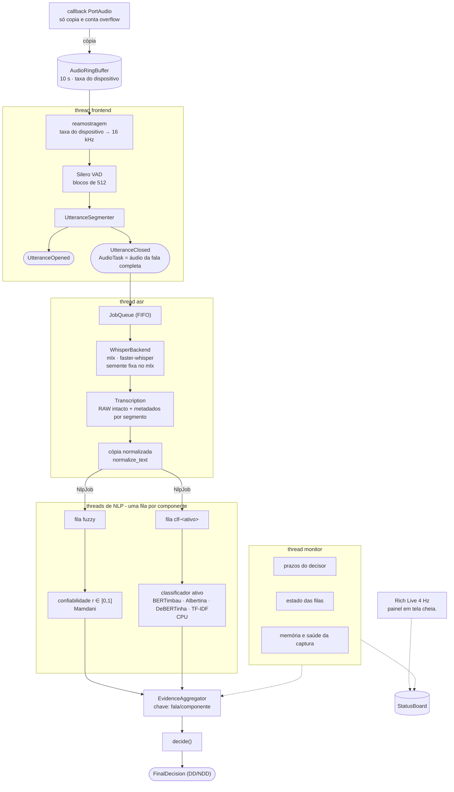

# Arquitetura detalhada do pipeline em tempo real

## Fluxo

## Componentes

| Módulo | Responsabilidade |
|---|---|
| `audio/capture.py` | `sounddevice.InputStream` mono na taxa nativa; callback só copia e conta overflow; `restart()` recarrega o PortAudio |
| `audio/ring_buffer.py` | Buffer circular pré-alocado; leitura com deslocamento absoluto; perdas contadas, nunca silenciosas |
| `audio/resampler.py` | `soxr.ResampleStream` com estado (blocos arbitrários = sinal inteiro) |
| `vad/silero.py` | Silero VAD ONNX (1 thread), blocos de 512 a 16 kHz |
| `vad/segmenter.py` | Máquina de estados da fala: histerese, pre-roll, pós-roll, limite máximo, continuação |
| `asr/backends.py` | mlx-whisper (GPU) e faster-whisper (CPU) com decodificação idêntica; no mlx, a semente fixa (`[asr] seed`) torna as transcrições reprodutíveis |
| `asr/types.py` | `WhisperSegment`/`Transcription`: só os campos que os dois backends fornecem |
| `text/normalization.py` | NFKD → sem acentos → minúsculas → pontuação/símbolos viram espaço → espaços colapsados |
| `fuzzy/reliability.py` | Confiabilidade da transcrição (avg_logprob, no_speech_prob, compression_ratio, temperatura) |
| `classifiers/hub.py` | Cópia local dos classificadores do Hugging Face (`models/<repositório>`); baixa o que faltar |
| `classifiers/model.py` | Modelo do Hugging Face ou execução de treino → modelo fp32 + limiar congelado; inferência de uma frase |
| `evaluation/baselines.py` | TF-IDF + Regressão Logística ou SVM, com a mesma interface, também usável no sistema |
| `decision/decider.py` | Agregador por fala e regra de decisão |
| `realtime/job_queue.py` | Fila FIFO bloqueante, sem descarte, com fechamento |
| `realtime/workers.py` | Uma thread por modelo; o modelo é carregado dentro da própria thread |
| `realtime/pipeline.py` | Montagem, eventos, encerramento seguro, modo de arquivo |
| `observability/` | `SystemLogger` (só `info`/`debug`/`warn`/`error`), `StatusBoard`, painel |

## Concorrência

| Thread | Faz | Nunca faz |
|---|---|---|
| Callback PortAudio | Copia o bloco para o buffer circular e conta flags | Alocação grande, log, lock longo |
| `frontend` | Reamostragem, VAD, segmentação (bem acima do tempo real) | Inferência pesada |
| `asr` | Única dona do Whisper/MLX | - |
| `fuzzy`, `clf-*` | Um componente por thread; sem chamadas concorrentes no mesmo modelo | - |
| `monitor` | Prazos, estatísticas, reabertura da captura | - |
| Rich `Live` | Renderiza o snapshot 4×/s | Bloquear produtores |

- A captura nunca depende do ASR: o callback só escreve no buffer circular, e o frontend só enfileira.
- Só a thread `asr` usa a GPU (MLX). Os classificadores rodam na CPU em fp32, com
  `torch.set_num_threads` configurável. O Neural Engine não é usado: nem MLX nem PyTorch o expõem
  para estes modelos.
- Ordem sem corrida: a evidência de uma tarefa é registrada no agregador **antes** de a tarefa entrar
  na fila.

## Buffers e filas

| Estrutura | Capacidade | Política |
|---|---|---|
| Buffer circular | 10 s | Se o leitor parar mais de 10 s, sobrescreve e **conta** as amostras perdidas; o frontend expõe a lacuna e fecha a fala aberta com o motivo `erro` |
| Pre-roll | 300 ms | Circular, para não cortar o primeiro fonema |
| Fala | 30 s (pré-alocado) | No limite, fecha (`limite_maximo`) e abre a continuação na amostra seguinte |
| Fila do ASR | sem limite | Uma tarefa por fala, em ordem de fechamento. Nada é descartado: a quantidade é limitada pela própria fala humana |
| Filas de NLP | sem limite | Mesma política |

## Identificadores

- Fala `U0007`; processamento da fala completa `U0007-F`.
- Cada tarefa e resultado carrega um `AudioSpan` em amostras absolutas a 16 kHz e o instante de captura.
- O agregador indexa por (fala, componente) e rejeita (com `error`) chave desconhecida, repetida ou
  com modelo trocado. Resultado que chega depois da decisão gera `warn` e é ignorado.

## Decisão

1. Rótulo: um classificador por vez (`[classifiers] active` ou `--classificador`; padrão BERTimbau).
   - A decisão da fala é o rótulo dele na transcrição da fala completa, com o limiar escolhido na
     validação.
   - Os cinco modelos (três Transformers e dois TF-IDF) são alternativas, e só o ativo é carregado.
2. Fuzzy: a confiabilidade acompanha cada decisão. Confiabilidade baixa só gera alerta e **não** muda o
   rótulo; a política "baixa → NDD" é avaliada offline.
3. Falhas: sem texto → NDD; ASR com erro → NDD; classificador sem resposta → NDD.
4. Prazos: 5 s para as análises, contados do fim da transcrição; 60 s contra travamento do ASR.
5. **Unidade de decisão:** cada fala gera uma única tarefa, a fala completa, transcrita quando o
   detector de voz a fecha.

## Controles do painel (`realtime/keys.py`)

O teclado é lido em modo cbreak, sem eco e sem Enter. O Ctrl+C continua valendo, e o terminal é
restaurado ao sair.

- **Microfone (`M`, espaço):** `Pipeline.pause_capture()` fecha o stream do PortAudio.
  - O frontend fecha a fala aberta como final (`close_reason = "pausa"`); ela é decidida
    normalmente.
  - A vigilância de travamento fica suspensa, para o microfone não ser reaberto sozinho.
  - Na retomada, o VAD e os reamostradores recomeçam do zero.
- **Classificador (`1` `2` `3` `C`):** troca entre os três Transformers. O TF-IDF entra só pela
  linha de comando (`--classificador baseline_logreg`). O classificador é fixado **por fala**, na
  abertura, então uma fala nunca mistura modelos.
  - Na primeira troca, o modelo é carregado na thread do próprio worker, em segundo plano. Enquanto
    carrega, as falas seguem com o atual.
  - Depois, o modelo fica em memória e a troca é imediata.
  - Ordem das travas: agregador → controles. Nada chama o agregador segurando a trava de controles.
- **Contexto gravado:** com `--gravar`, cada decisão registra o classificador com que a fala foi
  processada.

## Gravação da sessão (`--gravar`)

`SessionRecorder` (`realtime/session.py`) recebe dois tipos de item:
- o áudio da tarefa final, enviado pela thread do frontend **antes** de a tarefa entrar na fila do ASR;
- a decisão, enviada pela thread do agregador.

Os dois tipos vão para uma fila sem limite e são escritos por uma thread própria. A fila é FIFO,
então o WAV de uma fala sempre é escrito antes da linha da decisão dela. Nada é descartado:
- se o disco atrasar, a fila cresce e gera um aviso;
- uma falha de escrita é contada e registrada como erro, mas nunca derruba o pipeline.

No encerramento, `close()` escreve o que restou e registra o resumo em `sessao.json`: falas,
decisões, erros e itens pendentes.

## Erros e encerramento

- **Captura:** overflow → `warn` e contador; entrada silenciosa por mais de 2 s → `warn` (permissão
  ou dispositivo mudo); sem dados por 2 s → reabertura com o PortAudio recarregado.
- **Componentes:** falha vira resultado com erro (nunca some). Falha ao carregar modelo → encerra
  com mensagem clara.
- **Ctrl+C/SIGTERM:**
  1. Para a captura.
  2. A fala aberta vira final.
  3. As finais são drenadas, com prazo.
  4. As filas são fechadas e as threads unidas.
  5. Resumo impresso.
